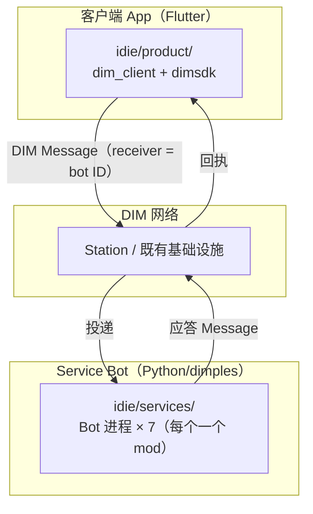
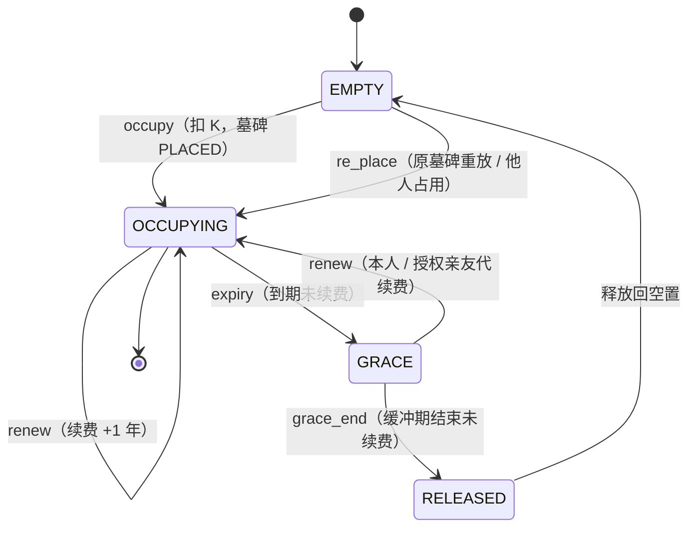
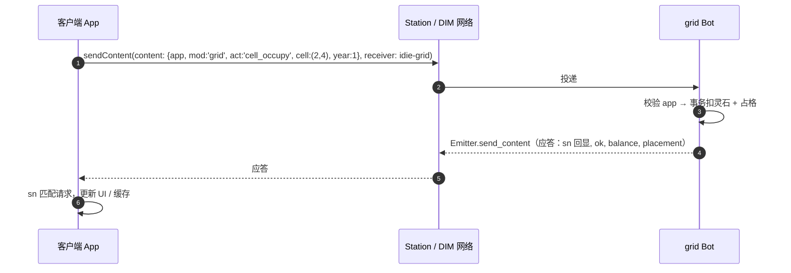

# 09 技术架构设计（Idie · 爱戴 — DIMP 双端架构）

> 作者：Toby（服务端架构）＋ Balon（前端架构）｜审核：Teddy｜日期：2026-10-24
> 输入：docs/01-08 全部设计 + 需求评审会结论（30+ 工程决策）
> 协议基准：DIMP（Decentralized Instant Messaging Protocol）CustomizedContent

## 1. 总体架构

**架构形态**：不架设自营服务器，**服务端 = DIM 网络中的 Service Bots**。客户端（Flutter App）通过 DIM 客户端 SDK 与各业务 Bot 通信，所有请求/应答封装在 **DIM Message 的 content** 中。



- 通信载体：DIM Message（Envelope + Content），content 为 JSON 对象。
- **请求**：客户端 `sendContent(content, receiver: bot_id)`；**应答**：Bot 通过 `Emitter.send_content(content, receiver: 请求者)` 返回。
- 请求/应答匹配：**content.sn 回显**（应答 content 携带请求 sn）。
- 客户端离线：DIM 消息投递由 Station 托管，Bot 应答进入客户端收件箱（dim_flutter 本地存储）。

## 2. 应用协议契约（本项目定制的 CustomizedContent）

所有业务消息 content 遵循 DIMP 官方 `CustomizedContent` 结构：

```json
{
  "type" : "204",                    // ContentType.CUSTOMIZED = 0xCC（十进制 204，协议统一按字符串）
  "sn"   : 12345,                    // 消息序号（应答回显）
  "time" : 1729728000,               // 发送时间（Unix 秒，公共属性）

  "app"  : "chat.dim.idie",          // 恒等于 chat.dim.idie（应用标识）
  "mod"  : "grid",                   // 模块名 = Bot 名（每个 Bot 一个 mod）
  "act"  : "cell_occupy",            // 动作名
  ...                                // 其余业务参数直接放 content 顶层
}
```

- 两端实现：Python 用 `AppCustomizedContent.create(app, mod, act)`（dimples 原生）；Flutter 用 `Content({...})` + `ContentType.CUSTOMIZED` 常量（dimp 2.5.3 原生）。
- **校验规则**：Bot 收到 content 先校验 `app == 'chat.dim.idie'`，否则按未知内容拒绝（记日志）。
- **参数命名**：业务参数全部放 content 顶层（小写 snake_case），与 app/mod/act 同级；禁止使用 `type/sn/time/from/to/group` 等协议保留键作业务参数。

## 3. Bot 拆分（每个 Bot 一个 mod，独立进程）

| mod | Bot 职责 | 主要 act | 数据读写 |
|---|---|---|---|
| `account` | 账号、登录、资料、签到、邀请 | register / login / profile_get / profile_update / checkin / invite | User 表、Checkin 表、Invite 表 |
| `grid` | 网格浏览、占格/续费/释放/重放 | cells_get / cell_status / cell_occupy / cell_renew / cell_re_place | Cell、Placement 表 |
| `tomb` | 墓碑创建/编辑、头像、可见性、渲染数据 | tomb_create / tomb_update / tomb_get / avatar_set / visibility_set | Tombstone 表 |
| `economy` | 灵石余额/流水/充值/结算/首充 | balance_get / ledger_list / packages_get / purchase / first_charge / ledger_rebate | Ledger、Purchase 表、配置 |
| `interact` | 献花、献爱心、纪念日、互动记录 | flower_send / heart_send / interact_list / remember_set | Interaction 表、体力 Redis |
| `govern` | 举报、抽查、处置、风控 | report_submit / report_status / risk_ping | Report 表 |
| `system` | 配置下发、公告、客户端版本 | config_get / config_update(admin) / notice | 配置存储 |

- **进程模型**：`idie/services/` 下每个 mod 一个入口（仿 service-py `sebot_*.py` 模式）：`idie_<mod>.py` + 共享 `shared.py`（GlobalVariable 单例：数据库、messenger、配置）+ 每 bot 一个 `engine/<mod>_service.py`（继承 BaseService 实现 `_process_customized_content`）。
- **Bot ID**：`bots.ini` 配置，命名 `idie-<mod>@<domain>`（如 `idie-grid@dim.chat`）；客户端 receiver 直接填该 ID。
- **单 bot 内 act 分发**：`_process_customized_content` 中 `if mod==self.mod: 按 act 字典分发`；未知 act → 返回错误应答（见 §6 错误码）。

### 3.2 状态机速览（完整定义见 docs/03）



> 墓碑状态并行：`PLACED`（展示中，含缓冲期）↔ `UNPLACED`（格子释放后卸下，仅"我的-墓碑管理"可见）；墓碑数据永不删除（L-003）。

## 4. 消息流转时序（以占格为例）



- 失败场景：余额不足 → 应答 `{ok:false, code:1001, msg:'灵石不足'}`；格子被抢 → `{ok:false, code:1002}`。

## 5. 客户端工程规划（Balon）

**工程**：`idie/product/`（Flutter，可在 Android Studio 编译运行；iOS 同工程，TestFlight 30 人 3 周）。
- 依赖：`dim_client 1.7.1`（pub.dev，传递依赖 dimsdk 2.5.2 / mkm 2.5.3）+ `object_key`；`dim_flutter` / tarsier **仅作参考**（用户指示：不基于其开发）；UI 组件可参考 tarsier（网格视图、联系人、设置等）。
- **目录结构**：
```
idie/product/
├── pubspec.yaml            # 依赖 dim_flutter(path) + dimsdk
├── lib/
│   ├── main.dart           # 入口：启动 DIM 客户端（Station 连接/登录）
│   ├── core/               # 通信层：IdieApi（统一 send/receive + sn 匹配）、配置缓存
│   ├── models/             # 领域模型（Cell/Tombstone/Ledger/...）
│   ├── services/           # 各 mod 的本地服务封装（AccountApi/GridApi/TombApi/EconomyApi/InteractApi/GovernApi/SystemApi）
│   ├── views/              # 页面：网格、墓碑详情、创建流程、我的、设置、审核
│   └── widgets/            # 网格虚拟化、墓碑渲染（SVG 模板）、体力进度条、特效
└── android/ ios/ ...       # 平台工程（AS 可直接打开 android/）
```
- **通信层核心**（Balon 定义）：`IdieApi.request(mod, act, params) -> Future<Map>`：构造 CustomizedContent → `SharedMessenger.sendContent(content, receiver: botId(mod))` → 注册 sn 回调 → 应答到达后 `SharedProcessor` 分发回请求方（超时 15s 报错）。
- **本地缓存**：sqflite 存网格区块、墓碑、用户配置；SharedPreferences 存登录态。

## 6. 服务端工程规划（Toby）

**工程**：`idie/services/`（PyCharm 工程），复用 service-py 骨架：
```
idie/services/
├── requirements.txt        # dimples + redis + 业务依赖
├── bots.ini                # bot ID / 数据库 / redis / 各 mod 配置
├── start_all.sh / shell_start.sh / shell_stop.sh   # 一键启停 7 个 bot 进程
├── bots/
│   ├── shared.py           # GlobalVariable 单例（数据库、messenger、配置、扩展加载）
│   └── idie_account.py / idie_grid.py / idie_tomb.py / idie_economy.py /
│       idie_interact.py / idie_govern.py / idie_system.py    # 7 个 bot 入口
├── engine/
│   ├── base_service.py     # 继承 libs/client/processor.py 的 Service：app 校验 + act 分发骨架
│   └── account_service.py / grid_service.py / tomb_service.py / economy_service.py /
│       interact_service.py / govern_service.py / system_service.py
├── libs/                   # 沿用 service-py libs（client/database/utils）
└── database/
    ├── models.py           # 数据表结构（见 docs/11）
    └── redis_keys.py       # 体力/风控/配置 key 规范
```
- **数据库**：复用 `libs.database.Database`（AccountDBI/MessageDBI/SessionDBI + 业务扩展）；业务表见 docs/11。
- **配置中心**：O/P 系列全部参数 + 促销系数 + 阈值存配置（bots.ini / 数据库 config 表），客户端 `system.config_get` 拉取；60s 生效。

## 7. 错误码规范

| code | 含义 | 客户端处理 |
|---|---|---|
| 0 | 成功 | — |
| 1001 | 灵石不足 | 引导充值 |
| 1002 | 格子已被占用 | 提示重选 |
| 1003 | 体力不足 | 显示恢复倒计时 |
| 1004 | 参数校验失败 | 表单提示 |
| 1005 | 权限不足（非 owner/非受邀） | 提示 |
| 1006 | 内容违规（命中风控） | 提示审核中 |
| 1007 | 墓碑不存在/未展示 | 提示 |
| 2001 | 未登录/登录失效 | 跳登录 |
| 9000 | 服务内部错误 | 重试 |

## 8. 安全与合规落点

- 所有业务消息经 DIM 加密通道（SecureMessage），Bot 端仅处理已认证 Sender；无额外鉴权层（协议层承担）。
- 敏感操作（占格/充值/删除）依赖 DIM 数字签名（消息级），幂等键在业务层（docs/01 §2）。
- 日志脱敏：不打印 content 明文中的姓名/头像 URL；错误日志只记 mod/act/sn。

> 待 Toby/Balon 补充确认：Bot ID 具体域名、Station 接入点配置、客户端登录注册流程细节（与 tarsier 对齐）。
